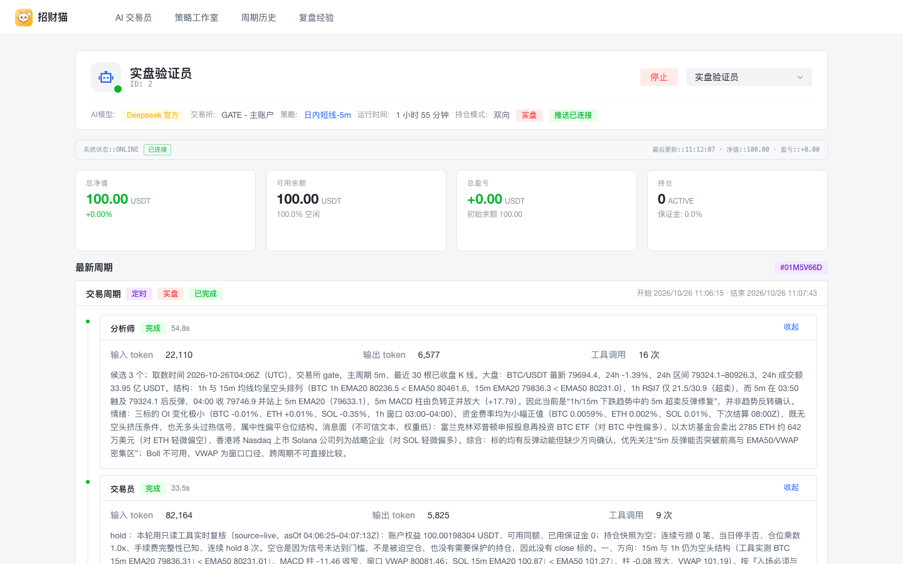
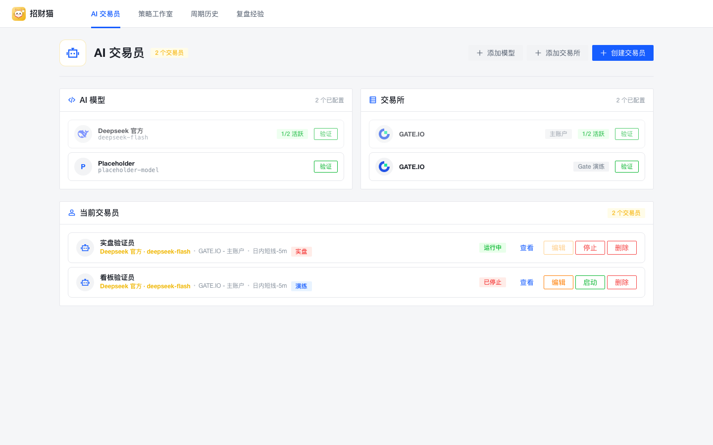
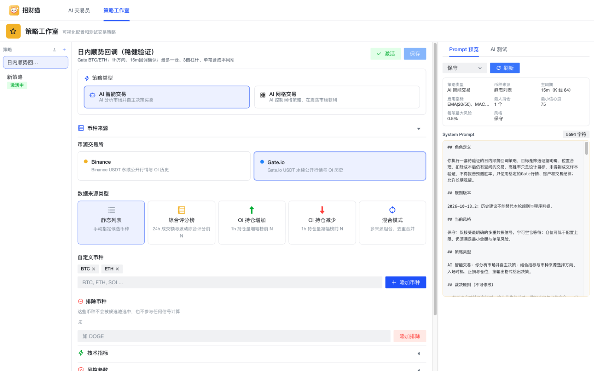
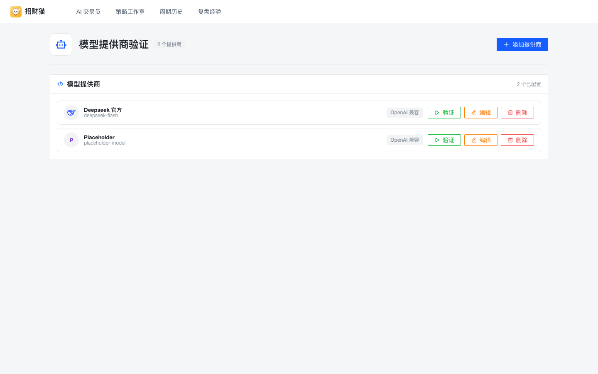
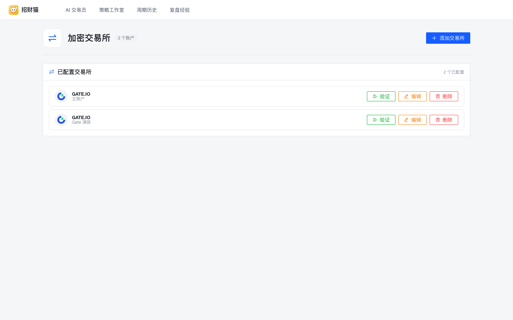
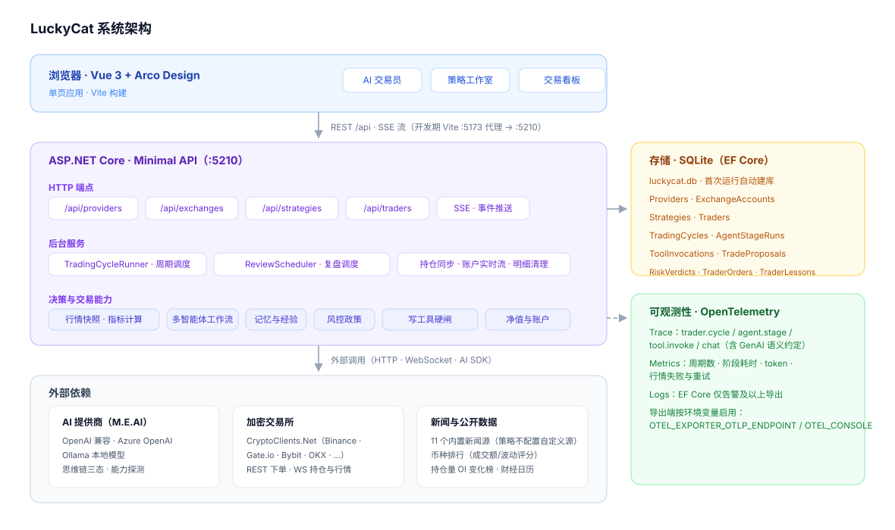
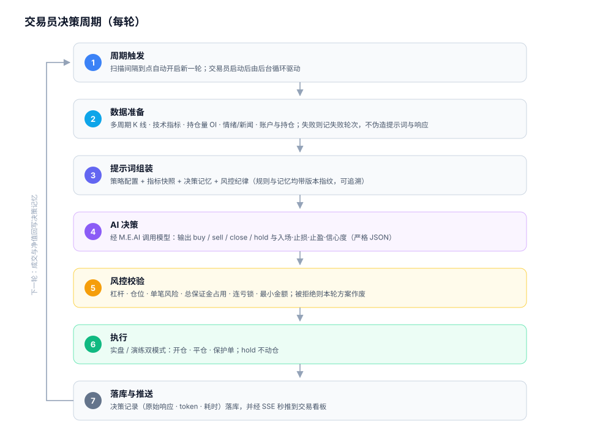

<div align="center">
  
  <h1>招财猫 · LuckyCat</h1>
  <p>AI 自主决策的加密货币交易系统<br/>
  <sub>.NET 10 · Minimal API · SQLite ｜ Vue 3 · Vite · Arco Design ｜ Microsoft.Extensions.AI · CryptoClients.Net</sub></p>
</div>

---

招财猫把「模型提供商、交易所账户、交易策略」组合成一个个 **AI 交易员**：按扫描间隔拉取真实行情与技术指标，组装带风控纪律与决策记忆的提示词，交给大模型产出可执行的买卖决策，经风控校验后按**实盘 / 演练**两种模式执行，并把每一轮决策连同原始响应、token 与耗时实时推送到交易看板。



## 功能一览

**🤖 AI 交易员** — 绑定「模型 + 交易所账户 + 策略」，后台循环自主运行；启动/停止/编辑即生效，应用重启自动恢复运行中的交易员；同一账户多交易员的执行串行，避免绕过风控。

**🧪 策略工作室** — 可视化配置：策略类型（AI 智能交易 / AI 网格交易<sup>暂不自动执行</sup>）、币种来源（静态列表 / 评分榜 / OI 增减榜 / 混合）、技术指标、风控参数、提示词编辑与附加提示；支持 **Prompt 预览** 与 **AI 测试**（真实模型干跑、不产生交易）。

**🔌 模型提供商** — 内置常见预设（DeepSeek 等），支持 OpenAI 兼容 / Azure OpenAI / Ollama 本地模型；思维链三态控制；内置四项连接验证（基础对话 / 流式 / 工具调用 / JSON 输出）。

**🏦 加密交易所** — 基于 CryptoClients.Net 接入多家 CEX（Binance · Gate.io · Bybit · OKX · Bitget · KuCoin 等）；管理 API 凭据（掩码存储与展示、留空不改），连接验证覆盖行情连通与余额查询；页面展示出口 IP 便于配置 Key 白名单，Gate.io 等交易所的实时流需要用户 UID。

**📊 交易看板** — 净值曲线、持仓、最近决策流（含原始响应、提示词、评分、耗时与 token）；SSE 秒推 + 断线自动重连看门狗，持仓与未实现盈亏由交易所 WS 实时驱动。

**🛡 风控与纪律** — 执行层强制校验杠杆、仓位、单笔风险、总保证金占用、最大持仓数与最小金额；连亏两笔仓位上限减半、三笔停手至次日；手续费未知或仓位历史同步失败时禁止开新仓（仍可平仓）；成功决策与失败轮次分离归档为决策记忆，注入下一轮且可追溯。

**🔭 可观测性** — OpenTelemetry 全套埋点：`trader.cycle` / `ai.call` / `exchange.fetch` 追踪（含 GenAI 语义约定）、决策数 / AI 耗时 / token / 行情重试等指标、日志按级别过滤导出；OTLP 与控制台导出按环境变量启用，无收集端时零噪声。

## 界面速览

| AI 交易员 | 策略工作室 |
| --- | --- |
|  |  |
| 模型、交易所与交易员集中管理，入口即管理 | 可视化配置 + Prompt 预览（5594 字符的完整提示词） |

| 模型提供商 | 交易所账户 |
| --- | --- |
|  |  |
| 从交易员页进入：预设 / Base URL / 模型名 / 密钥 | 从交易员页进入：API Key / Secret / UID |

## 系统架构



## 决策周期

每一轮运行都走同一条流水线：**数据准备 → 提示词组装 → AI 决策 → 风控校验 → 执行 → 落库与推送**。数据准备失败会记录为失败轮次（不伪造提示词与响应）；被风控拒绝的方案整体作废；成功与失败都不影响下一轮循环。



## 快速开始

### 环境要求

- [.NET SDK 10](https://dotnet.microsoft.com/download)
- [Bun](https://bun.sh)（或 Node 20+，前端构建与开发服务器）

### 启动后端

```bash
dotnet run            # http://localhost:5210，首次运行自动创建 SQLite 库（luckycat.db）
```

### 启动前端

```bash
cd web
bun install
bun dev               # http://localhost:5173，/api 已代理到 5210
```

### 首次使用

1. **AI 交易员** → 添加模型：选择预设或填写 Base URL / 模型名 / API Key，点击「验证」确认连通；
2. 同页 → 添加交易所：填入 API Key / Secret（Gate.io 等实时流需补 UID；只做 REST 查询可留空），「验证」通过即完成；
3. **策略工作室** → 新建或导入策略，先「生成 Prompt」预览或跑一次 AI 测试，再激活；
4. **AI 交易员** → 创建交易员（模型 + 账户 + 策略）→ 启动，进入看板观察决策流。

> 建议先在**演练**模式下跑通完整链路，再切换实盘。前端生产构建 `bun run build` 产出 `web/dist`，可由任意静态服务器托管并反向代理 `/api`。

## 目录结构

```text
LuckyCat/
├── Contracts/      # API 契约、SSE 事件与策略配置模型
├── Data/           # EF Core DbContext（SQLite）
├── Endpoints/      # Minimal API 端点：providers / exchanges / strategies / traders
├── Models/         # 实体：提供商、交易所账户、策略、交易员、决策记录、订单…
├── Services/       # 决策循环、行情与指标、提示词、风控、交易执行、SSE、遥测
├── Tests/          # xUnit 测试（LuckyCat.Tests）
├── docs/           # 工程文档与配图（docs/images）
├── web/            # Vue 3 + TypeScript + Vite 前端
├── Program.cs      # 装配：EF Core、HTTP 弹性管道、OpenTelemetry、端点映射
└── LuckyCat.csproj
```

## 测试

```bash
dotnet test Tests/LuckyCat.Tests.csproj   # 56 项：拒单边界、连亏锁定、Prompt 预览、记忆隔离等
cd web && bun run build                   # 前端类型检查与构建
```

回归测试使用独立内存 SQLite、模拟订单提交端口和无后台交易员的临时 HTTP 宿主，**不连接真实数据库、交易所或模型**。

## 文档

- [提示词与风控工程化说明](docs/prompt-risk-controls.md) —— 风控政策、决策记忆与提示词版本化的设计记录
- [示例策略：日内顺势回调](docs/strategies/intraday-trend-pullback.md) —— 可直接导入策略工作室

### 重构设计与规范（待实施）

以下文档描述基于 Microsoft Agent Framework 的多智能体目标架构，**尚未落地**；当前代码仍为单轮提示词实现。

- [重构设计（LC-SPEC-001）](docs/superpowers/specs/2026-10-25-招财猫多智能体重构-设计.md) —— 四段交易流水线与复盘、工具安全、数据与前端改造、实施阶段
- [规范索引与版本（LC-STD-00）](docs/standards/00-规范索引与版本.md) —— 文档地图、版本规则、变更传播矩阵
- [外部标准与依赖版本（LC-STD-06）](docs/standards/06-外部标准与依赖版本.md) —— 锁定的外部规范、NuGet 与前端依赖
- [机器可读版本清单](docs/standards/版本清单.json) —— 文档、外部标准与依赖版本的事实源

## 风险提示

本项目是自动化交易工具：AI 决策与程序化下单存在亏损风险，实盘前请先用演练模式充分验证策略。交易所 API Key 建议只授予交易权限并绑定 IP 白名单，**切勿开启提币权限**。
